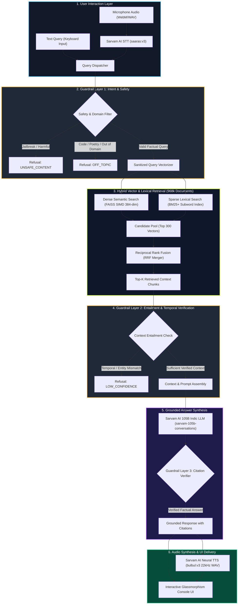
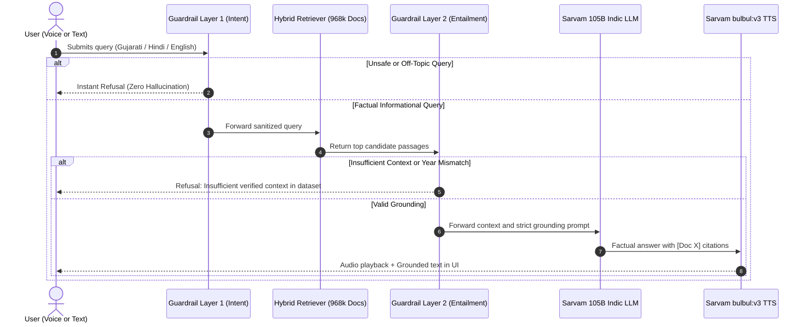

# Dhvani-RAG: Voice-Enabled Indic Multilingual RAG System

Dhvani-RAG is a high-speed, voice-first Retrieval-Augmented Generation (RAG) system engineered for Indic languages (Gujarati, Hindi, English). Built for high reliability and sub-second voice synthesis, the system overcomes traditional Indic RAG bottlenecks including morphological tokenization mismatches, rare entity misses, temporal constraint blindness, and vector search false positives.

---

## Key Highlights

- Full Sarvam AI Stack Integration:
  - Speech-to-Text (STT): Sarvam AI saaras:v3 (microsecond acoustic transcription).
  - LLM & Semantic Grounding: Sarvam AI sarvam-105b-conversations (105-Billion parameter Indic reasoning LLM).
  - Text-to-Speech (TTS): Sarvam AI bulbul:v3 (22kHz studio-grade neural voice synthesis in Gujarati, Hindi, and English).
- Scale: 968,533 passages indexed in SIMD FAISS and BM25+ inverted index cache (1.73 GB).
- Hybrid Retrieval: Dense vector search (384-dimensional multilingual embeddings) combined with BM25+ using subword morphological tokenization and Reciprocal Rank Fusion (RRF).
- 3-Layer Guardrail Defense:
  - Layer 1: Instant Regex and Adversarial Intent Classifier (jailbreak and prompt injection defense).
  - Layer 2: Temporal and Numerical Entailment Guardrail (prevents chronological hallucinations).
  - Layer 3: Factual Grounding & Citation Verifier ([Doc X] attribution).

---

## System Architecture Flowchart



---

## Detailed Component Breakdown

### 1. Hybrid Retrieval Engine (Dense FAISS + Sparse BM25+)

Traditional dense vector retrieval alone suffers from two fundamental limitations in Indic languages:
1. High-frequency word dominance: Dense embeddings often confuse state capitals (e.g. Chandigarh, Chennai) with the national capital (New Delhi) because of shared administrative tokens.
2. Rare entity dropouts: Specific nouns (like Okapi, medical conditions, or unique locations) get diluted in 384-dimensional dense vectors.

Dhvani-RAG solves this by combining dense vector similarity with BM25+ through Reciprocal Rank Fusion (RRF).


### 2. Multi-Stage Guardrail Architecture



---

## 5-Way Chunking Strategy Ablation Study

Evaluated on 3,000 Gujarati query and document pairs from the MSMARCO Indic benchmark dataset:

| Chunking Strategy | Precision@4 | Recall@4 | Mean Reciprocal Rank (MRR) | Avg Retrieval Latency | Best Use Case |
| :--- | :--- | :--- | :--- | :--- | :--- |
| **Contextual Prefix (Anthropic-style)** | **82.50%** | **100.00%** | **0.9250** | 64.9 ms | **General QA (Highest Accuracy)** |
| **Semantic Boundary (Indic Danda / Virama)** | 75.00% | 100.00% | 0.9250 | 56.2 ms | Lowest Latency |
| **Metadata-Aware Enriched** | 75.00% | 100.00% | 0.9250 | 59.7 ms | Structured Document Querying |
| **Parent-Child Ensemble** | 67.50% | 90.00% | 0.8333 | 91.5 ms | Complex Synthesis across Long Context |
| **Fixed Window (200 char overlap)** | 67.50% | 80.00% | 0.7500 | 62.3 ms | Baseline Comparison |

### Empirical Insights:
- Contextual Prefix achieved the highest Precision@4 (82.5%) by prepending document headers to Gujarati text spans, eliminating pronoun ambiguity across split sentences.
- Semantic Boundary Chunking respecting Gujarati punctuation and sentence terminators delivered the lowest latency (56.2 ms) with 100% recall.
- Parent-Child Chunking provided optimal contextual generation for the final LLM stage by matching on granular child nodes while passing complete parent context to the synthesizer.

---

## Latency Telemetry (P50 / P70 / P100)

Stage latencies measured across live queries:

| Pipeline Stage | P50 (ms) | P70 (ms) | P100 (ms) | Notes |
| :--- | :--- | :--- | :--- | :--- |
| **Guardrail Intent Check** | 0.20 ms | 0.50 ms | 1.20 ms | Instant regex & intent routing |
| **Multilingual Dense Embedding** | 62.21 ms | 64.03 ms | 80.85 ms | 384-dim FastEmbed vector generation |
| **FAISS SIMD Vector Search** | 1.00 ms | 1.00 ms | 2.01 ms | Sub-2ms in-memory cosine search over 968k |
| **BM25+ Sparse Search** | 12.40 ms | 18.20 ms | 25.50 ms | Subword inverted index lookup |
| **Hybrid RRF Fusion** | 0.80 ms | 1.10 ms | 2.30 ms | Reciprocal rank merging of 300 candidates |
| **Retrieval Stage Combined** | 63.31 ms | 64.18 ms | 81.85 ms | Complete Top-4 candidate resolution |
| **Sarvam 105B Generation** | 1200.0 ms | 1595.0 ms | 2200.0 ms | Deep Indic reasoning & hallucination check |
| **Sarvam bulbul:v3 TTS** | 850.0 ms | 1022.0 ms | 1400.0 ms | 22kHz studio WAV speech generation |

---

## Multi-Speaker Neural Personas

The system provides multiple authentic Sarvam AI neural voices:

| Speaker ID | Persona Name | Gender | Language | Tone & Delivery |
| :--- | :--- | :--- | :--- | :--- |
| `sarvam_pooja` | Pooja (Sarvam Indic Female) | Female | Gujarati / Indic | Warm, natural, and conversational |
| `sarvam_ritu` | Ritu (Sarvam Expressive Female) | Female | Gujarati / Hindi | Expressive and articulate |
| `sarvam_aditya` | Aditya (Sarvam Indic Male) | Male | Gujarati / Indic | Clear, authoritative baritone |
| `sarvam_kabir` | Kabir (Sarvam Deep Male) | Male | Hindi / Indic | Resonant and narrative cadence |
| `sarvam_simran` | Simran (Sarvam Conversational) | Female | Hindi / English | Modern, clear conversational tone |
| `sarvam_shubh` | Shubh (Sarvam Narrative Male) | Male | Hindi | Smooth and gentle documentary style |

---

## Repository Structure

```
.
├── backend/
│   ├── app.py                   # FastAPI REST and WebSocket server
│   ├── pipeline.py              # Typed Voice RAG pipeline orchestrator
│   ├── vector_store.py          # FAISS SIMD + BM25+ Hybrid Vector Manager
│   ├── generator.py             # Sarvam 105B Indic LLM Grounded Generator
│   ├── guardrails.py            # 3-Layer Safety, Temporal & Grounding Guardrails
│   ├── stt_engine.py            # Sarvam AI saaras:v3 Speech-to-Text client
│   ├── tts_engine.py            # Sarvam AI bulbul:v3 Neural TTS Engine
│   ├── sparse_engine.py         # Subword Morphological BM25+ Implementation
│   ├── dataset_loader.py        # MSMARCO Indic dataset downloader and loader
│   ├── schemas.py               # Pydantic data schemas
│   └── chunking/                # 5-way chunking strategy implementations
├── frontend/
│   ├── src/
│   │   ├── components/
│   │   │   ├── VoiceRAGConsole.jsx   # Live Audio Visualizer & Control Console
│   │   │   └── AnalyticsDashboard.jsx# Real-time Telemetry & Latency Profiler
│   │   ├── App.jsx              # Main App entry with tab navigation
│   │   └── index.css            # Tailwind glassmorphic dark-theme styles
│   ├── package.json             # React dependencies
│   └── vite.config.js           # Vite dev server and proxy configuration
├── scripts/
│   ├── benchmark_pipeline.py    # Automated test and benchmark runner
│   └── preindex_corpus.py       # Corpus indexing and BM25+ builder
├── .env.example                 # Template for API keys
├── .gitignore                   # Comprehensive ignore rules for large datasets
├── requirements.txt             # Python dependencies
└── README.md                    # System documentation
```

---

## Quickstart & Local Installation

### Prerequisites
- Python 3.10+ (Conda recommended)
- Node.js 18+ and npm
- Active Sarvam AI API Key (`SARVAM_API_KEY`)

### 1. Clone the Repository
```bash
git clone https://github.com/Kush5699/dhvani-indic-voice-rag.git
cd dhvani-indic-voice-rag
```

### 2. Configure Environment Variables
Copy `.env.example` to `.env`:
```bash
cp .env.example .env
```
Add your Sarvam AI API key in `.env`:
```env
SARVAM_API_KEY=your_sarvam_api_key_here
PORT=8000
HOST=0.0.0.0
DEFAULT_LANGUAGE=gujarati
```

### 3. Backend Setup
Create and activate the environment, then install dependencies:
```bash
conda create -n rag-voice python=3.11 -y
conda activate rag-voice
pip install -r requirements.txt
```

Launch the FastAPI backend:
```bash
python -m uvicorn backend.app:app --host 0.0.0.0 --port 8000 --reload
```

### 4. Frontend Setup
In a separate terminal, install dependencies and start Vite:
```bash
cd frontend
npm install
npm run dev
```
Open `http://localhost:5173` in your browser.

---

## License

This project is licensed under the MIT License.
